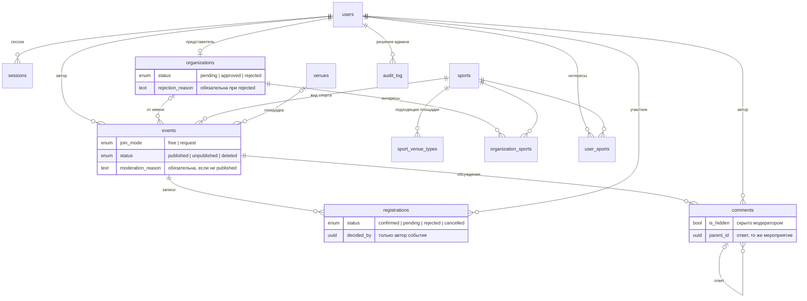

# Схема базы данных

Код схемы — [apps/api/src/db/schema/](../apps/api/src/db/schema/) (Drizzle ORM, PostgreSQL). Она собрана целиком и сразу по [DATA_MODEL.md](DATA_MODEL.md): все таблицы, поля и связи уже на месте, поэтому участникам не нужно дописывать поля в чужие модели по ходу работы.

Проверено: drizzle-orm 0.44.2, drizzle-kit 0.31.1, PostgreSQL 17 (PGlite). Схема применяется без ошибок, 45 проверок проходят: допустимые данные принимаются, каждое нарушение ниже отклоняется базой.

## Связи

## Файлы и владельцы

| Файл               | Таблицы                                | Владелец |
| ------------------ | -------------------------------------- | -------- |
| `common.ts`        | перечисления (enum), колонки времени   | 3        |
| `users.ts`         | `users`, `sessions`                    | 3        |
| `sports.ts`        | `sports`, `user_sports`                | 1        |
| `organizations.ts` | `organizations`, `organization_sports` | 2        |
| `venues.ts`        | `venues`, `sport_venue_types`          | 2        |
| `events.ts`        | `events`                               | 1        |
| `registrations.ts` | `registrations`                        | 1        |
| `comments.ts`      | `comments`                             | 1        |
| `audit.ts`         | `audit_log`, `app_meta`                | 3        |

Владелец меняет свой файл. Если меняется форма таблицы, он же правит сид (3.7), чтобы `pnpm db:seed` не ломался у остальных.

## Какие проблемы закрывает

| Проблема                                                                        | Решение в схеме                                                                                                                                 |
| ------------------------------------------------------------------------------- | ----------------------------------------------------------------------------------------------------------------------------------------------- |
| Админке (3.4–3.6) нужно менять чужие модели: `Organization`, `Event`, `Comment` | Поля модерации заведены сразу. Пишет их **только модуль `admin`**, владельцы таблиц их только читают. Запрос в `REQUESTS.md` для этого не нужен |
| `events` правили бы трое: участник 1, плюс организация (2.6) и площадка (1.10)  | Все поля события, включая `organization_id`, `venue_id`, `lat`, `lng` и модерацию, уже в таблице                                                |
| Связка `SportVenueType` без владельца                                           | Лежит в `venues.ts`, владелец — участник 2                                                                                                      |
| Кто решает заявку: панель (2) или записи (1)                                    | Таблица и правила переходов — у участника 1. Панель организатора вызывает его сервис, а не пишет свой SQL                                       |
| Админ не должен решать заявки участников (ТЗ)                                   | Составной ключ `(event_id, decided_by) → events (id, created_by)`: решение может записать только автор события                                  |
| Событие «от имени» чужой организации                                            | Составной ключ `(organization_id, created_by) → organizations (id, owner_id)`                                                                   |
| Ответы организатора в 1.8 и в панели 2.7                                        | Одна таблица `comments`: ответ — комментарий с `parent_id`. Ответ под другим мероприятием база не примет                                        |
| Снятие без причины, отказ без причины — организатор не поймёт, что случилось    | `CHECK`: у `rejected`-организации и не `published`-события причина обязательна, и в журнале тоже                                                |
| Бесплатный Render засыпает, при пробуждении сид стёр бы данные экспертов        | `app_meta.seed_version`: сид при старте наполняет базу, только если версия в коде новее записанной                                              |

## Что гарантирует база

- Email уникален без учёта регистра; у представителя одна организация; название уникально среди допущенных.
- Свой вид спорта не дублирует существующий (`slug`) и всегда имеет автора.
- Одна запись на пару «событие — пользователь»: отмена и повторная запись меняют статус.
- Решение по заявке может принять только автор события; отказ всегда с автором решения и датой.
- Ответ на комментарий — в том же мероприятии; скрытый комментарий всегда с модератором.
- Координаты — парой и в допустимом диапазоне; конец события позже начала; лимит мест от 1.
- Действие в журнале соответствует типу цели; отказ, снятие и удаление — с причиной.

## Что проверяет сервер (база этого не может)

| Правило                                                                                                                                                 | Задача   |
| ------------------------------------------------------------------------------------------------------------------------------------------------------- | -------- |
| Публиковать от имени организации можно только в статусе `approved`                                                                                      | 2.4, 2.6 |
| Нельзя записаться на своё, снятое, удалённое, прошедшее или заполненное событие. Проверка мест — в транзакции с `SELECT … FOR UPDATE` на строке события | 1.6      |
| Роль `admin` не выдаётся регистрацией; `organization_id` у события ставит только аккаунт `organization`                                                 | 3.2, 2.6 |
| Глубина ответов 1; писать под снятым событием нельзя; текст скрытого комментария не отдаётся в API                                                      | 1.8      |
| Видимость участников и `chat_url` по таблице из DATA_MODEL                                                                                              | 1.5      |

## Как пользоваться

- Поиск по тексту — тем же выражением, что в индексе, иначе он не используется:
  `to_tsvector('russian', title || ' ' || description) @@ websearch_to_tsquery('russian', $1)`.
  Русская морфология работает: запрос «футбола» находит «Футбол во дворе».
- Связи для `db.query` заданы: например, `db.query.events.findMany({ with: { author: true, registrations: { with: { user: true } } } })`.
- Перечисления экспортируются массивами (`EVENT_STATUSES` и т.д.): `packages/shared` строит из них Zod-схемы, а не копирует строки.
- Подключение в каркасе (3.1): `drizzle.config.ts` со `schema: './src/db/schema/index.ts'`, `pnpm db:push`.

## Отличия от DATA_MODEL.md

По правилам контракта их нужно внести в `DATA_MODEL.md` отдельным маленьким PR:

1. Новая служебная таблица `app_meta` (ключ — значение) для `seed_version`.
2. `audit_log.action` и `target_type` — перечисления, а не строки; значения те же.
3. Добавлены `updated_at` у `organizations` и `registrations`.
4. Владелец `user_sports` — участник 1 (профиль), `sport_venue_types` — участник 2.
5. «Удалить комментарий» из 3.6 реализуется как скрытие: строки не удаляются, как и события.
